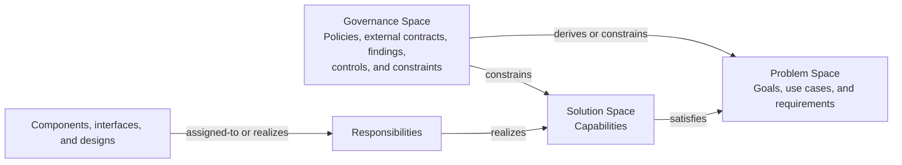
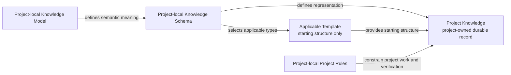

# Knowledge Architecture and Artifact Responsibilities

> Evidence source: [`.scaffold/knowledge-model.md`](../../.scaffold/knowledge-model.md), [`.scaffold/knowledge-schema.md`](../../.scaffold/knowledge-schema.md), [`.scaffold/rules/`](../../.scaffold/rules/), and [`.scaffold/agent-guide.md`](../../.scaffold/agent-guide.md), inspected 2026-11-13. These project-local files provide active semantic, representation, and policy guidance. Their additional role as the single maintained distribution source is defined by [DEC-006](default-artifacts.md#dec-006); the package archive and extracted-package initialization were verified on 2026-11-13.

## Capabilities and Architecture

### CAP-001 — Durable knowledge separation

Provide a shared structure that separates intended outcomes, reusable constraints, and technical realization while retaining the relationships among them.

Relationships:

- Related-to: [CON-003 — Durable source-of-truth boundaries](../governance/product-operating-boundaries.md#con-003).

#### Responsibilities

##### RESP-001 — Operational knowledge-space classification

Realizes: CAP-001

Before creating or changing durable knowledge, partition each claim into Project Context, Problem, Governance, or Solution according to its primary meaning, then preserve the explicit relationships that connect the resulting records. For mixed behavior-and-implementation claims, establish or reuse the Problem obligation and observable acceptance before linking the realizing Solution knowledge. Governance may derive a Problem obligation or directly constrain Solution knowledge when its applicability supports that relationship. Do not create a Problem record merely because a claim has been classified; keep a pure technical decision in Solution unless an external obligation or outcome changes.

This responsibility includes distinguishing shared terminology and domain meaning from technical representation, with policy allocation defined by DEC-006.

Relationships:

- Satisfies: [REQ-019 — Operational knowledge-space partitioning](../problem/knowledge-authority-and-customization.md#req-019).

#### Components and Boundaries

See Shared Architecture for component assignments and interaction boundaries.

### CAP-002 — Deliberate guidance authority

Provide distinct semantic, representation, and operating-policy authorities so a project can customize its knowledge vocabulary and guidance deliberately.

Relationships:

- Satisfies: [REQ-016 — Project-local active Harness authority](../problem/knowledge-authority-and-customization.md#req-016).

#### Responsibilities

##### RESP-002 — Semantic authority stewardship

Realizes: CAP-002

Resolve the active Knowledge Model as the authority for concepts and relationship meaning.

##### RESP-003 — Representation and policy resolution

Realizes: CAP-002

Resolve the complete project-local active Harness and apply the Model, Schema, Rules, Templates, Skills, and guide within their distinct authority domains.

Relationships:

- Satisfies: [REQ-017 — Materialized Harness initialization](../problem/knowledge-authority-and-customization.md#req-017).
- Related-to: [CAP-004 — Package candidate and starter artifact provision](default-artifacts.md#cap-004).
- Related-to: [DEC-001 — Schema-selected template applicability](default-artifacts.md#dec-001).
- Related-to: [DEC-004 — Project Context representation](default-artifacts.md#dec-004).
- Related-to: [RESP-004 — Hybrid allocation guidance](hybrid-agent-tool-architecture.md#resp-004) applies these knowledge authorities to hybrid Solution records.

#### Components and Boundaries

See Shared Architecture for component assignments and interaction boundaries.

### CAP-003 — Deliberate model migration mapping

Provide a Markdown-readable, project-owned crosswalk for reviewing semantic correspondences and non-correspondences while replacing a Knowledge Model.

Relationships:

- Satisfies: [REQ-015 — Deliberate Knowledge Model migration mapping](../problem/knowledge-authority-and-customization.md#req-015).

#### Responsibilities

##### RESP-004 — Model migration crosswalk stewardship

Realizes: CAP-003

Define and review mappings between source and target Model concepts and relationships, and between Schema-owned represented fields with their source and target Schemas identified. Record mapping kind, cardinality, identity and reference treatment, migration disposition, and unresolved ambiguity. Keep one Model active and require deliberate project-owned migration decisions.

#### Components and Boundaries

See Shared Architecture for component assignments and interaction boundaries.

### Shared Architecture

#### Components and Boundaries

##### IFC-001 — Knowledge-space relationship model

The three spaces form a connected graph, not a required document hierarchy or one-to-one delivery chain.

- **Problem Space** owns stakeholder intent and externally meaningful obligations: actors, goals, use cases, requirements, and acceptance criteria. It answers why work matters and what must be true without prescribing unmandated implementation.
- **Governance Space** owns reusable or external obligations and their applicability: policies, external contracts, findings, controls, and constraints. It can derive requirements or constrain Solution knowledge directly when appropriate.
- **Solution Space** owns the intentional technical structure that realizes applicable obligations: capabilities, responsibilities, components, interfaces, designs, decisions, and Verification Items. Project Rules own the project-wide verification approach; execution results are evidence rather than automatically durable Solution knowledge.
- A finding is evidence, not automatically a control; a control, constraint, or requirement requires justified scope and applicability. A solution capability is not a business goal, and a decision does not redefine a requirement.

##### IFC-002 — Guidance-authority relationship model

- The **Knowledge Model** defines the meaning of durable concepts and relationships. The project-local Model is active after initialization; the installed package Model is an initialization and update candidate only. It does not dictate document layout or workflow mechanics.
- The **Knowledge Schema** defines how project knowledge is represented: document types, heading names and order, identifiers, references, and template selection. The project-local Schema is active and does not describe or redefine the active Model's concepts.
- **Project Rules** define how project work should or must be performed, such as coding, documentation, verification, architecture, and delivery practices. The project's local Rules form the active collection. Rules do not redefine Model semantics or Schema representation.
- **Templates** provide starting structure and template-local completion instructions that refer to active-Model concepts. The active Schema—not template availability—determines whether a template type applies; a field name has no shared meaning outside its selected template.
- Existing project knowledge remains the project-owned durable record. When creating or updating it, first partition each claim as Project Context, Problem, Governance, or Solution; then apply the Model for meaning, the active Schema for representation and template selection, the selected Template's local completion instructions, and active applicable Rules as policy authority for how the work is performed.
- During Project Knowledge reconciliation, a Git baseline identifies the accepted record and the resulting Project-Knowledge diff is candidate state. Candidate state is not authoritative merely because it appears in the working repository; a clean independent review automatically accepts it, while reviewer-reported conflicts or material ambiguities remain non-accepted until resolved.
- No artifact overrides another outside its authority domain: Rules cannot redefine Schema representation, Skills cannot redefine Workflow completion, and Workflows cannot redefine the active Model's semantics.

## Satisfies

- CAP-001 — Durable knowledge separation satisfies:
  - [REQ-019 — Operational knowledge-space partitioning](../problem/knowledge-authority-and-customization.md#req-019)
- CAP-002 — Deliberate guidance authority satisfies:
  - [REQ-016 — Project-local active Harness authority](../problem/knowledge-authority-and-customization.md#req-016)
  - [REQ-017 — Materialized Harness initialization](../problem/knowledge-authority-and-customization.md#req-017)
- CAP-003 — Deliberate model migration mapping satisfies:
  - [REQ-015 — Deliberate Knowledge Model migration mapping](../problem/knowledge-authority-and-customization.md#req-015)

## Design and Decisions

### DEC-001 — Three connected knowledge spaces

Scaffold represents durable knowledge primarily in Problem, Governance, and Solution spaces, with Project Context as the Schema-owned orientation representation. Classification follows semantic meaning rather than folder structure, and the spaces remain many-to-many connected through explicit relationships. Every claim is partitioned before it is recorded: mixed behavior and implementation first establishes or reuses a Problem obligation and observable acceptance, then links its realizing Solution knowledge; applicable Governance either derives that Problem obligation or directly constrains Solution knowledge; and pure technical decisions remain Solution-only unless they alter an external obligation or outcome. This is a classification policy, not a reason to manufacture Problem records.

### DEC-002 — Separate semantic, representation, and policy authority

The active project-local Knowledge Model is the semantic contract and the sole source of concept and relationship meaning. The active project-local Knowledge Schema encodes and decodes that contract without making a field name a second semantic definition. Each selected local Template provides completion instructions that refer to Model concepts. Local Project Rules guide project work. Keeping these authorities distinct avoids shared/local resolution and implicit merging; material cross-authority disagreement is reconciled in the artifact outside its authority rather than decided by a global precedence chain.

### DEC-003 — Conceptually structured, physically coherent knowledge

Knowledge objects may have independent semantic identities without requiring one physical file per object. The default representation favors sufficiently contextual Markdown documents; a project may adopt a more granular representation only through its active Knowledge Schema. A Problem document represents one coherent subject, not every item that happens to share a project, actor, dependency, implementation area, or repository layout. Connections among separate subjects remain explicit relationships rather than implicit document containment.

Project Context is a lightweight, Schema-owned orientation representation for project-wide purpose, goals, terms, scope, exclusions, and material unknowns. It is distinct from a Problem document and does not add a semantic space or redefine Goals, which remain Problem-space concepts under the Knowledge Model.

Under the default Schema, Project Context's Domain Terms provides the single shared definition of established domain vocabulary, including vocabulary that originated in implementation. Requirements and acceptance criteria use that definition to state intended behavior. Technical representations and mappings are retained in Solution only when they have durable reasoning value, with explicit links to the domain meaning or obligations they realize.

### DEC-005 — Explicit model-migration crosswalks

A Knowledge Model replacement may require a project-owned Crosswalk that maps concepts or relationships as equivalent, renamed, split, merged, superseded, retired, or unmapped. A Schema replacement may map represented fields only with the source and target Schemas identified. Each mapping records cardinality and identity treatment so many-to-many correspondences remain expressible. The Crosswalk informs a deliberate migration; it neither combines Model authority nor enables automatic semantic rewriting.

### DEC-006 — Policy-guided partitioning without a semantic CLI validator

The active Project Rules are the operating-policy authority for knowledge work, while the active Knowledge Model remains the authority for the meanings being partitioned. The agent guide owns shared authority resolution and applicable-policy discovery; Project Rules own operational classification guidance. Workflow and method Skills consume that guidance through the guide rather than restating Model/Schema authority, classification procedures, or a fixed default knowledge taxonomy. The command-line interface remains limited to mechanical support and does not add a deterministic semantic-classification validator. Agents apply the policy and report material uncertainty rather than fabricate relationships.

The existing `core.knowledge-space-partition` Rule is the designated authority for applying the terminology distinction and change-impact cases in [REQ-019](../problem/knowledge-authority-and-customization.md#req-019). Reconstruction guidance consumes that Rule as described by [DEC-005 — Reconstruction separates domain evidence from representation](default-artifacts.md#dec-005); it must not become a second copy of the policy. This extends the existing partition design without adding a Model concept, Schema category, or separate terminology Rule. The Rule contains the classification procedure; reconstruction declares the evidence-based result it must produce. Generic Skills retain task-specific outcomes, relevant-guidance declarations, and lifecycle boundaries. Compatible Model, Schema, and classification-Rule customization is resolved in those active authorities and through the guide without requiring copied policy edits across generic Skills; a change to a workflow-specific outcome still requires deliberate reconciliation. Presence of those instructions is distinct from completed verification of an agent applying them.

## Verification Items

### VER-001 — Project-local active-artifact authority

Verifies:

- [AC-022 — Active artifacts resolve project-locally](../problem/knowledge-authority-and-customization.md#ac-022).

Scope:

- authority boundaries among the active Knowledge Model and replaceable artifacts.

Expected evidence:

- runtime resolution uses only the materialized project-local Model, Schema, Rules, Templates, Skills, and agent guide, without package fallback or merging.
- the agent guide supplies shared Model/Schema authority resolution to Skills; Skills preserve their task-specific outcomes without maintaining another authority or precedence definition.

### VER-002 — Policy-guided knowledge-space partitioning

Verifies:

- [AC-025 — Knowledge claims are partitioned before recording](../problem/knowledge-authority-and-customization.md#ac-025).

Scope:

- default Rules and Skills that guide creating and changing Project Knowledge.

Expected evidence:

- guidance requires claim classification before recording, uses active Project Rules as policy authority, preserves the Problem-first treatment for mixed behavior-and-implementation claims, permits Governance-derived Problems and direct Solution constraints, and keeps pure technical decisions Solution-only when no external obligation or outcome changes.
- the default guidance locates shared definitions in Project Context / Domain Terms, permits Problem obligations to use their domain meanings, and keeps durable technical representations or mappings in linked Solution knowledge without making shared naming an implementation mandate.
- operational classification procedures remain in applicable Rules, reached through agent-guide policy resolution; generic Skills require the classification result and affected relationships without embedding the default taxonomy or repeating the procedure.

Assumptions:

- semantic assessment remains agent-mediated under [CON-002](../governance/product-operating-boundaries.md#con-002); the CLI provides no deterministic semantic-classification validator.

### VER-003 — Internal representation changes preserve Problem obligations

Verifies:

- [AC-026 — Internal representation changes preserve domain obligations](../problem/knowledge-authority-and-customization.md#ac-026).

Scope:

- guidance for knowledge impact when an internal status is renamed or split while domain meaning, behavior, and applicable contracts are unchanged.

Expected evidence:

- the guidance preserves Problem obligations and reconciles only affected durable Solution knowledge; a mechanical change with no stale durable knowledge requires no knowledge update.

### VER-004 — Domain meaning and vocabulary changes are distinguished

Verifies:

- [AC-027 — Domain changes and vocabulary changes have distinct impact](../problem/knowledge-authority-and-customization.md#ac-027).

Scope:

- guidance for changes to intended domain meaning or observable lifecycle compared with changes only to stakeholder vocabulary.

Expected evidence:

- meaning or lifecycle changes reconcile affected requirements, acceptance criteria, and dependent knowledge; vocabulary-only changes update definitions and affected references without manufacturing changed behavioral obligations.

### VER-005 — External exact-value mandates survive classification

Verifies:

- [AC-028 — Mandated exact values remain traceable obligations](../problem/knowledge-authority-and-customization.md#ac-028).

Scope:

- partition guidance applied to an identified external status-value contract.

Expected evidence:

- the guidance preserves the mandate's Governance source and applicability, together with the derived requirements or constrained interfaces that retain the exact values.
